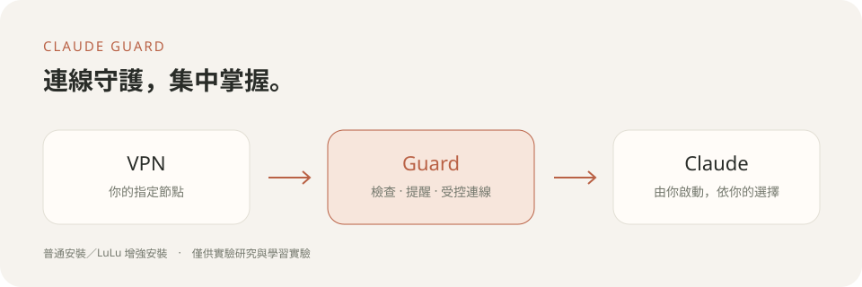

# Claude Guard

[简体中文](README.zh-CN.md) · **繁體中文**

為中國 🇨🇳、香港 🇭🇰與澳門 🇲🇴地區使用者設計的 Claude 連線守護工具。將連線檢查與狀態提醒集中在輕巧視窗，讓日常工作更從容。這是獨立工具，與 Anthropic 無隸屬關係，不代表上述地區獲得官方存取支援。

[下載最新版](https://github.com/Riko-Neko/claude-guard/releases) · [開發與測試](https://github.com/Riko-Neko/claude-guard/blob/main/docs/DEVELOPMENT.md) · [第三方依賴](https://github.com/Riko-Neko/claude-guard/blob/main/THIRD_PARTY_NOTICES.md)

## 安裝與設定

從 [Releases](https://github.com/Riko-Neko/claude-guard/releases) 下載 `ClaudeGuard-0.10.16.pkg`，完全退出 Claude、Claude Code 與舊版 Guard 後再執行。完成後從「應用程式」開啟 Claude Guard，在同一視窗完成設定。

安裝優先嘗試官方免重新啟動激活。舊的待移除記錄只作狀態參考，不會阻止安裝。若本次激活未完成，可稍後重試或自行選擇普通模式；Guard 不會強迫重新啟動或自動降低保護方式。既有 LuLu 設定會保留，並以「重新啟用」標示。

- **普通安裝（推薦）**：在 VPN 與 Claude 之間增加代理層，由 Guard 守護連線。
- **增強安裝（需要進階權限）**：額外安裝開源系統級網路過濾器 LuLu，適合需要更嚴格直連限制、並熟悉系統權限的使用者。

推薦使用 TUN 模式。選擇節點後，檢視並確認出口與裝置環境基準，再開始使用。完整設定流程固定顯示於視窗上方，詳細說明收進資訊按鈕。切換方式前請完全退出 Claude 與 Claude Code。

LuLu 安裝引導完成後，Guard 會接續套用規則並驗證。短暫連線逾時會在原步驟自動重試，已完成的步驟會保留；通過全部檢查後，設定視窗自動關閉。

## 日常使用

點選選單列盾牌，在小面板中檢查並啟動 Claude、查看結果或進入設定。介面支援繁體中文、簡體中文與英文，語言選擇位於視窗右上角。

出口預設每 5 秒複查；發現變更後暫停受控連線，需要重新核驗並批准。實際發現時間受網路及系統影響。裝置環境檢測預設每小時一次，異常只提醒。Claude 退出後停止定期檢測。

睡眠、網路切換或檢查逾時後，先暫停受控連線，每次複查結束後約 5 秒再重試；原節點、出口與保護狀態檢查通過後自動恢復，不反覆彈出相同告警。也可在盾牌選單點選「重新檢查並恢復連線」。若曾檢測到出口或節點參數改變，則停止自動恢復，仍須退出 Claude 並重新核驗批准。重開 Guard 不會接管已開啟的 Claude；請先完全退出 Claude 與 Claude Code，再由 Guard 啟動。增強設定完成後自動隱藏 LuLu 選單列圖示，網路過濾繼續運作。

本機 DNS 與 WebRTC 檢查不使用外部測試服務，不能證明不存在洩漏，也不能代表 Claude 自身的 WebRTC 行為。普通安裝無法阻止繞過 Guard 的連線；LuLu 增強安裝仍包含本機回環等例外，且會在系統範圍處理連線。

出口變化或連線檢查失敗時，Guard 會在選單列圖示旁顯示輕量提示，保留目前的輸入焦點，選單及設定頁也會保留原因；系統通知未授權或傳送失敗不會只剩提示音。未手動關閉的提示會在復查通過後顯示「連線已恢復」，約 1 秒後收起；手動關閉後不會再因恢復而彈出。檢查記錄會顯示時間與過期狀態，不能當成目前連線已通過。

## 關閉與移除

正常退出或移除請使用選單面板的入口。退出前先結束 Claude 與 Claude Code。透過「解除安裝」呼叫由 Guard 管理的 LuLu 官方解除安裝流程，再將 Guard 移到垃圾桶。強制結束或直接刪除應用程式不會保證完成聯動。

應用位於 `/Applications/Claude Guard.app`，執行檔隨應用攜帶；個人設定與紀錄位於 `~/Library/Application Support/Claude Guard/Runtime`。開發目錄不是執行依賴。重裝後首次開啟會歸檔舊資料，再建立新的設定。

## 實驗用途聲明

**本工具僅供實驗研究與學習實驗。所有使用者均應遵循 Anthropic 的使用政策。本工具不保證存取資格、帳號安全或零洩漏，不擔保任何形式的違規行為造成的損失。**

目前為 Apple Silicon 本機簽章候選版本，尚未經過開發者正式簽章及公證。需要 Python 3、系統 Ruby、命令列開發工具、Clash Verge 與原版 Claude。管理員授權方式由 macOS 決定，不能保證每次提供指紋。LuLu 官方授權視窗不受 Guard 的介面語言控制。

可公開的範圍僅限原始碼、圖示及說明；請勿分享個人設定、連線紀錄、訂閱或聊天資料。LuLu 為外部開源依賴，保留原版簽章與授權條款。

## 授權

原創程式碼與素材採用 [MIT 授權](LICENSE)，允許使用、修改與再發行並保留版權及授權聲明。第三方元件維持各自原有授權，詳見第三方聲明。
