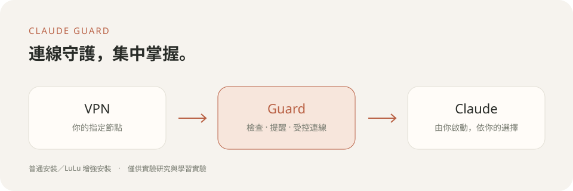

# Claude Guard

**简体中文** · [繁體中文](README.md)

为中国 🇨🇳、香港 🇭🇰和澳门 🇲🇴地区用户设计的 Claude 连接守护工具。将连接检查与状态提醒集中在轻巧窗口，让日常工作更从容。这是独立工具，与 Anthropic 无隶属关系，不代表上述地区获得官方访问支持。

[下载最新版](https://github.com/Riko-Neko/claude-guard/releases) · [开发与测试](https://github.com/Riko-Neko/claude-guard/blob/main/docs/DEVELOPMENT.md) · [第三方依赖](https://github.com/Riko-Neko/claude-guard/blob/main/THIRD_PARTY_NOTICES.md)

## 安装与配置

从 [Releases](https://github.com/Riko-Neko/claude-guard/releases) 下载 `ClaudeGuard-0.10.17.pkg`，完全退出 Claude、Claude Code 与旧版 Guard 后再运行。完成后从“应用程序”打开 Claude Guard，在同一个窗口完成配置。

安装优先尝试官方免重启激活。旧的待移除记录只作状态参考，不会阻止安装。若本次激活未完成，可稍后重试或自行选择普通模式；Guard 不会强迫重启或自动降低保护方式。现有 LuLu 设置会保留，并以“重新启用”标示。

- **普通安装（推荐）**：在 VPN 与 Claude 之间增加代理层，由 Guard 守护连接。
- **增强安装（需要高级权限）**：额外安装开源系统级网络过滤器 LuLu，适合需要更严格直连限制、并熟悉系统权限的用户。

### 实验性质与系统授权

Claude Guard 仍是实验性工具，尤其是 LuLu 增强模式：安装、初始化、配置或移除网络保护组件时，可能需要多次完成 macOS 管理员提权与系统扩展授权。

**我们承诺，这些提权仅用于 Guard 守护组件与 LuLu 网络保护所需的安装、规则配置、维护及移除，包括必要的备份与旧组件清理，不用于与连接守护无关的操作。** 相关实现均已公开，欢迎大家[核验授权调用](https://github.com/Riko-Neko/claude-guard/blob/main/tools/admin_authorization.py)、[安装与规则配置](https://github.com/Riko-Neko/claude-guard/blob/main/tools/gui_setup.py)及[关闭与移除流程](https://github.com/Riko-Neko/claude-guard/blob/main/tools/lifecycle.py)，提出问题或改进建议。

推荐使用 TUN 模式。选择节点后，检查并确认出口与设备环境基准，再开始使用。完整配置流程固定显示在窗口上方，详细说明收进信息按钮。切换方式前请完全退出 Claude 与 Claude Code。

LuLu 安装引导完成后，Guard 会接着应用规则并验证。临时连接超时会在原步骤自动重试，已完成的步骤会保留；通过全部检查后，配置窗口自动关闭。

## 日常使用

点击菜单栏盾牌，在小面板中检查并启动 Claude、查看结果或进入配置。界面支持繁体中文、简体中文与英语，语言选择位于窗口右上角。

出口默认每 5 秒复查；发现变化后暂停受控连接，需要重新核验并批准。实际发现时间受网络及系统影响。设备环境检测默认每小时一次，异常只提醒。Claude 退出后停止定期检测。

睡眠、网络切换或检查超时后，先暂停受控连接，每次复查结束后约 5 秒再重试；原节点、出口与保护状态检查通过后自动恢复，不反复弹出相同告警。也可在盾牌菜单点击“重新检查并恢复连接”。若曾检测到出口或节点参数改变，则停止自动恢复，仍须退出 Claude 并重新核验批准。重开 Guard 不会接管已打开的 Claude；请先完全退出 Claude 和 Claude Code，再由 Guard 启动。增强设置完成后自动隐藏 LuLu 菜单栏图标，网络过滤继续运行。

本地 DNS 与 WebRTC 检查不使用外部测试服务，不能证明不存在泄漏，也不能代表 Claude 自身的 WebRTC 行为。普通安装无法阻止绕过 Guard 的连接；LuLu 增强安装仍包含本机回环等例外，而且会在系统范围处理连接。

出口变化或连接检查失败时，Guard 会在菜单栏图标旁显示轻量提示，保留当前输入焦点，菜单及配置页也会保留原因；系统通知未授权或发送失败不会只剩提示音。未手动关闭的提示会在复查通过后显示“连接已恢复”，约 1 秒后收起；手动关闭后不会再因恢复而弹出。检查记录会显示时间与过期状态，不能当作当前连接已通过。

## 关闭与移除

正常退出或移除请使用菜单面板中的入口。退出前先结束 Claude 与 Claude Code。通过“卸载”调用由 Guard 管理的 LuLu 官方卸载流程，再将 Guard 移到废纸篓。强制退出或直接删除应用程序不保证完成联动。

应用位于 `/Applications/Claude Guard.app`，运行文件随应用携带；个人配置与日志位于 `~/Library/Application Support/Claude Guard/Runtime`。开发目录不是运行依赖。重装后首次打开会归档旧数据，再创建新配置。

## 实验用途声明

**本工具仅供实验研究与学习实验。所有用户均应遵循 Anthropic 的使用政策。本工具不保证访问资格、账号安全或零泄漏，不担保任何形式的违规行为造成的损失。**

目前为 Apple Silicon 本地签名候选版本，尚未经过开发者正式签名与公证。需要 Python 3、系统 Ruby、命令行开发工具、Clash Verge 与原版 Claude。管理员授权方式由 macOS 决定，不能保证每次提供指纹。LuLu 官方授权窗口不受 Guard 的界面语言控制。

可公开的范围仅限源码、图标及说明；请勿分享个人配置、连接日志、订阅或聊天数据。LuLu 是外部开源依赖，保留原版签名与许可条款。

## 授权

原创代码与素材采用 [MIT 许可](LICENSE)，允许使用、修改与再发布并保留版权及许可声明。第三方组件保持各自原有许可，详见第三方声明。
